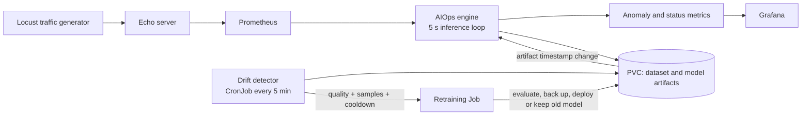

# AIOps / MLOps Platform on Kubernetes

An end-to-end learning project for operating an anomaly-detection service as a Kubernetes workload. It combines live telemetry, controlled failure injection, model inference, drift evaluation, automated retraining, observability, and delivery automation.

The goal is deliberately practical: make the full feedback loop visible and testable, from an unhealthy service signal to a model decision and a guarded deployment.

## What this project demonstrates

- **Kubernetes operations:** Deployments, CronJobs, Jobs, Services, probes, PVC-backed shared data, resource requests, and RBAC.
- **Observability:** Prometheus metrics and Grafana dashboards for service health, anomaly scores, model quality, drift, retraining progress, and audit events.
- **MLOps workflow:** Feature extraction from time-series windows, supervised Random Forest inference, drift checks, data sufficiency gates, retraining, model artifact versioning, and rollback protection.
- **DevOps automation:** Dockerized components, GitHub Actions CI, security checks, image builds, rollout verification, and a manually triggered CD workflow.
- **Operational learning:** A documented experiment showing the difference between strong held-out test performance and weak live-data performance.

## Architecture



## Runtime flow

1. Locust drives a seven-phase workload against the Echo server: normal traffic, bursts, slow responses, errors, traffic drops, and CPU stress.
2. The AIOps engine queries Prometheus every five seconds and builds a 12-point, 60-second feature window.
3. The model classifies the window, exports metrics, records the features, and reports leading contributors through feature importance and standardized deviation.
4. A Kubernetes CronJob evaluates recent labeled windows every five minutes.
5. Retraining is considered only when model quality is below the configured ROC-AUC threshold, enough samples exist, and the cooldown permits it.
6. The retraining Job prepares data, trains a new model, compares it with the previous model, backs up artifacts, and deploys only when the rollback rule allows it.
7. The running engine detects updated artifacts and hot-reloads the model without a pod restart.

## Repository map

| Path | Responsibility |
| --- | --- |
| `aiops-engine/` | Inference loop, model monitoring, drift detection, retraining, and status export |
| `echo-server/` | Target HTTP service with controllable fault modes |
| `traffic-gen/` | Locust workload and fault-injection schedule |
| `training/` | Dataset preparation and model training |
| `monitoring/` | Evaluation, drift analysis, and report generation |
| `k8s/` | Kubernetes resources for the platform and MLOps automation |
| `tests/` | Repository smoke tests for documentation and delivery contracts |
| `.github/workflows/` | CI checks and manually triggered CD |

## Engineering decisions worth reviewing

- **Retraining gates:** ROC-AUC below `0.80`, at least `200` samples, and a configurable time gate. The CronJob uses `Forbid` concurrency to avoid overlapping checks.
- **Deployment safeguard:** New models are evaluated before artifact replacement. The previous model is backed up and a model that exceeds the configured `0.02` ROC-AUC degradation tolerance is rejected.
- **Shared state:** PVCs preserve collected data, status, and model artifacts across pod restarts and allow the inference, drift, and retraining components to coordinate.
- **Least-privilege direction:** The drift detector uses a dedicated service account and RBAC rules limited to the batch and pod resources needed to launch and inspect retraining Jobs.
- **Runtime visibility:** Status is written as JSON and Prometheus-compatible metrics, creating an audit trail for model health, gate decisions, retraining steps, and rollback events.

## Observed validation result

The retraining lifecycle is documented in [`RETRAINING_LIFECYCLE_TIMELINE.md`](RETRAINING_LIFECYCLE_TIMELINE.md). In the recorded run:

| Check | Result |
| --- | --- |
| Initial live ROC-AUC | `0.506`, triggering the quality gate |
| Data sufficiency gate | Correctly blocked retraining at `50 < 200` samples |
| Retraining input | `18,631` labeled windows and `96` features |
| New model test ROC-AUC | `1.00` on the held-out split |
| Post-retrain live ROC-AUC | `0.505` |
| Interpretation | The automation worked, but retraining alone did not solve the distribution shift |

This is an important limitation, not a hidden success metric: the next engineering steps are stronger temporal validation, better labels, richer features, and an unsupervised or hybrid detector.

## Run locally

### Prerequisites

- Docker Desktop with Kubernetes enabled, or another accessible Kubernetes cluster
- `kubectl` configured for that cluster
- Python 3.12 for tests and repository scripts
- Bash through Git Bash or WSL on Windows

### Deploy the stack

```bash
git clone <repository-url>
cd AiOPs
bash deploy.sh latest
```

The deployment script builds the three images, applies the Kubernetes resources, waits for rollouts and readiness probes, and requests a rollback if deployment fails. For a staged deployment of the MLOps automation resources, use:

```bash
bash deploy-mlops-stack.sh
```

Useful local endpoints after port-forwarding include Prometheus on `9090`, Grafana on `3000`, and the Echo server on `5000`.

### Validate the repository

```bash
python -m pytest -q
bash -n deploy.sh
```

## CI/CD and security

The CI workflow runs on pushes and pull requests and performs:

- `pytest`
- the repository secret scanner in `scripts/scan_secrets.py`
- Bandit static analysis
- `pip-audit` dependency auditing
- Docker builds for the AIOps engine, Echo server, and traffic generator

The CD workflow is intentionally manual. It accepts an image tag, configures `kubectl` from the `KUBECONFIG_B64` GitHub secret, and invokes the same deployment script used locally. This keeps deployment credentials and cluster access explicit rather than pretending this learning cluster is production infrastructure.

### Secrets and production handling

`.gitignore` is committed on purpose: it prevents common local credentials, runtime files, datasets, and model binaries from being added accidentally in future clones. It is not a security boundary and it cannot remove secrets that were already committed. Real credentials must never be placed in YAML, source code, Docker images, notebooks, or Git history.

For this project:

- CI uses GitHub Actions secrets for cluster access. `KUBECONFIG_B64` is consumed only by the manual CD job and is not written to the repository.
- Grafana reads its admin password from the Kubernetes Secret `grafana-admin`; the repository contains no Grafana password and anonymous access is disabled.
- The lightweight scanner is a guardrail, not proof of safety. CI also runs Bandit and `pip-audit`, while GitHub secret scanning and push protection should be enabled on the repository.

For a production deployment, use short-lived GitHub OIDC or workload identity to authenticate to the cloud and cluster instead of storing a long-lived kubeconfig. Store application credentials in a managed secret system such as Azure Key Vault, AWS Secrets Manager, GCP Secret Manager, or HashiCorp Vault, and synchronize only the required values into Kubernetes through an external-secrets controller. Restrict access with least-privilege RBAC, rotate credentials, audit reads, mask them in logs, and use separate secrets per environment. If a secret is ever committed, revoke and rotate it immediately; deleting the file or adding it to `.gitignore` is not sufficient.

Before deploying Grafana locally, create its development secret without committing the value:

```bash
kubectl create secret generic grafana-admin \
	--namespace aiops \
	--from-literal=admin-password="$GRAFANA_ADMIN_PASSWORD" \
	--dry-run=client -o yaml | kubectl apply -f -
```

## Scope and next improvements

This is a portfolio and learning environment, not a production reference architecture. The current deployment uses local image assumptions, a single AIOps engine replica, phase-derived labels, and a simple file-based artifact exchange. Natural next steps are a container registry, immutable image digests, a model registry, stronger identity and network policies, multi-replica availability, temporal cross-validation, and automated integration tests against a disposable Kubernetes cluster.

